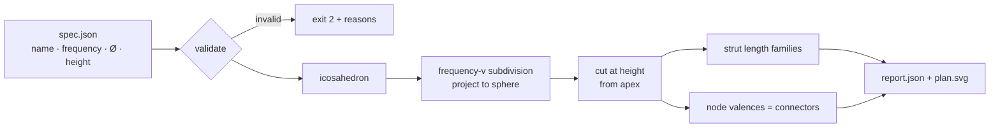

# ساباط — SÁBÁT · parametric pavilion explorer

*by ilghar.studio*

SÁBÁT is a modular pavilion (Ø 370 × H 230 cm; Texcycle yarn, recycled fabric, wood, metal, PLA) built on a geodesic dome. It is a space for hospitality, care and shared ritual, rooted in Zoroastrian philosophy. This repository is its **parametric explorer**. You give it a pavilion spec, and it works out the module system you'd need to fabricate:

- **Strut families:** how many module lengths there are, and how many of each to cut.
- **Connectors by valence:** the 3D-printed and machined nodes that join 4, 5 or 6 struts.
- **Model height, panel count and total strut length.**

## How it works



## Run it (Python ≥ 3.11, no dependencies)

```bash
python3 -m sabat fixtures/sabat_pavilion.json --svg site/sabat_plan.svg
python3 -m unittest
```

Real output for the thesis pavilion (`fixtures/sabat_pavilion.json`: 3V, Ø 370, H 230):

| | |
|---|---|
| height | Built pavilion H 230 cm; model height 219.7 cm, the panel-row cut closest to it |
| nodes / struts / panels | 61 / 165 / 105 |
| strut families | A 64.5 cm × 30 · B 74.7 cm × 55 · C 76.3 cm × 80 |
| connectors | 15 × 4-way · 6 × 5-way · 40 × 6-way |
| total strut length | 121.47 m |

### Connector table (computed from the geometry)

| hub | count | strut elevation below tangent plane | angle between neighboring struts |
|---|---|---|---|
| 4-way (rim) | 15 | 11.63–11.91° | 59.99–180° (180° = open rim side) |
| 5-way | 6 | 10.03–10.04° | 71.99–72.01° |
| 6-way | 40 | 10.03–11.91° | 55.68–62.17° |

### Panel acoustic proxy: **heuristic, not a measured acoustic result**

For each panel, the tool reports:

- `facing_centre`: the |cos| between the panel's normal and the direction to the centre of the floor.

These are geometric indicators only, with no acoustic simulation or measurement behind them. For the thesis pavilion, the mean facing_centre is 0.988. Facing is almost uniform because the floor centre sits close to the sphere's centre. Every value is in `fixtures/expected_output.json` under `panel_proxy_HEURISTIC`.

### Robustness
- **Height cut:** the tool picks the panel-row cut whose model height is closest to the target. It prints a warning if the result is more than 5% off, and gives a clear error if the height is too small for the chosen frequency and diameter.
- **Input checks:** it rejects specs that aren't JSON objects, numbers that are NaN, infinite or out of range (diameter 10–100,000 cm), and empty names.
- **Safe output:** the name is escaped in the SVG, and a missing or invalid JSON file gives a clear error message.
- **Strut lengths:** struts are grouped by a relative tolerance rather than by rounding.

### Themes
`site/index.html` uses the studio light and `.dark` design tokens. It follows `prefers-color-scheme`. A button in the top corner names the mode it will switch to, remembers your choice, and tells screen readers whether dark mode is on. The plan SVG and the 3D view are colored through CSS variables. The 3D view can be rotated by dragging, or by focusing it with Tab and using the arrow keys.

Contrast, measured on the rendered page (headless Chrome, computed colors): all page text is plum `#4a3a5c` in light mode (9.13:1 on the canvas, 10.05:1 on the button surface) and `#f4eef3` in dark mode (8.36:1 on the canvas, 6.50:1 on the button surface), so it meets WCAG AA (4.5:1). The front struts of the 3D view meet the 3:1 graphics minimum (9.13:1 light, 4.89:1 dark); the back struts and plan infills are deliberately lighter depth cues and fall below 3:1. The text baked into the project board images is not covered by this measurement. `tests/test_adversarial.py` checks the token pairs.

Open `site/index.html` to see the plan view.

### Checked against published tables
`tests/test_published.py` compares chord factors, strut counts, connector counts and bend angles for a Class I 3V 5/8 dome against the published tables in Desert Domes ("Dome Formulas") cross-checked with Domerama ("Chord factor charts"). Only the numbers are used; no code is copied.

## Original vision: still to build
- **Acoustic and atmospheric scoring:** score each panel infill for sound and atmosphere, balancing stability against acoustic harmony.
- **Connector CAD:** generate parametric connector geometry for the three main 3D-printed and machined connectors.
- **Textile envelope:** plan the knitted envelope made from used clothes, as a collection of memories.
- **Structural testing:** add statistical and structural testing.
- **Interactive 3D view (started):** `site/index.html` has a drag-to-rotate vanilla JS/SVG view; next: panel shading and textile envelope.
- **"Gateways to heaven" study:** compare cosmological geometry across Chogha Zanbil, the Isfahan Friday Mosque, the Louvre pyramid and Notre-Dame.

## References
[1] Sussan Babaie, “Isfahan x. Monuments (2) Palaces”, *Encyclopaedia Iranica* (published 2007, updated 2014), https://www.iranicaonline.org/articles/isfahan-x2-palaces/ (dates the top floor's decorated private rooms of the ʿĀli Qāpu to around 1615, under Shah ʿAbbās I).

© ilghar.studio. All rights reserved. Private.
