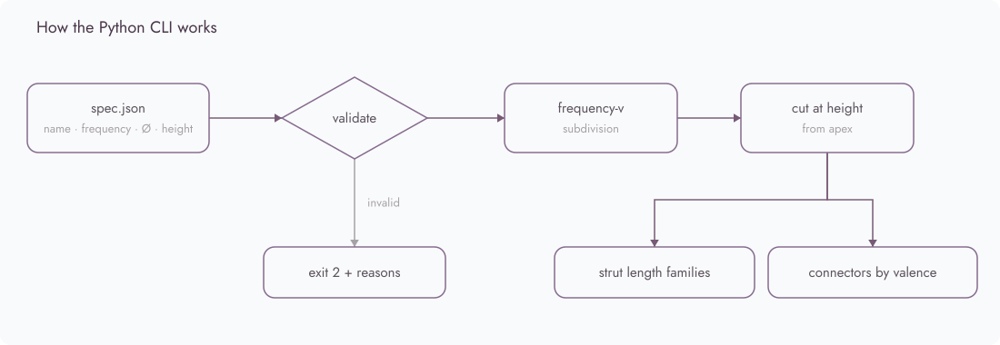

<p align="center">
  <a href="https://ilghar.github.io/sabat-parametric-explorer/">
    <picture>
      <source media="(prefers-color-scheme: dark)" srcset="docs/hero/hero-dark.webp">
      
    </picture>
  </a>
</p>

# ساباط — SÁBÁT · parametric pavilion explorer

A live parametric explorer for the SÁBÁT pavilion, so you can adjust the frame and see the parts needed to build it.

Open the live app: [ilghar.github.io/sabat-parametric-explorer](https://ilghar.github.io/sabat-parametric-explorer/) · Repository: [Ilghar/sabat-parametric-explorer](https://github.com/Ilghar/sabat-parametric-explorer) · [ilghar.studio](https://ilghar.studio)

## How it's used

Sliders for diameter, pyramid peak (built 57 cm), legs and stick thickness. Covers on or off, entrance open or closed. A connector selector with technical drawings, a live 3D model, and STL download. Parts tables update as the geometry changes.

### Connectors (live on Pages)

Each part is drawn and modelled from the slider values. At the built values every part matches the stage-1 originals.

<table>
  <tr>
    <td width="33%"><picture><source media="(prefers-color-scheme: dark)" srcset="assets/readme/hub5-dark.png"></picture><br><sub>5-way hub</sub></td>
    <td width="33%"><picture><source media="(prefers-color-scheme: dark)" srcset="assets/readme/hub6-dark.png"></picture><br><sub>6-way hub</sub></td>
    <td width="33%"><picture><source media="(prefers-color-scheme: dark)" srcset="assets/readme/corner-dark.png"></picture><br><sub>L corner 20A</sub></td>
  </tr>
  <tr>
    <td><picture><source media="(prefers-color-scheme: dark)" srcset="assets/readme/tee-dark.png"></picture><br><sub>T tee 2A</sub></td>
    <td><picture><source media="(prefers-color-scheme: dark)" srcset="assets/readme/ball-dark.png"></picture><br><sub>Ball connector</sub></td>
    <td><picture><source media="(prefers-color-scheme: dark)" srcset="assets/readme/peak-dark.png"></picture><br><sub>Peak connector</sub></td>
  </tr>
</table>

### Built pavilion

Ø 370 × H 230 cm · Texcycle yarn, recycled fabric, wood, metal, PLA · pavilion frame for hospitality, care and shared ritual.

> “SÁBÁT”, a structure commonly found in Yazd, Iran, series of interconnected arches or vaulted ceilings, harmonious blend of hospitality, grace, and cultural resonance.
> <cite>Hāèl, master thesis, 2024</cite>

### Also a Python CLI

You give it a pavilion spec, and it works out the module system you'd need to fabricate.

- Strut families: how many module lengths there are, and how many of each to cut.
- Connectors by valence: the 3D-printed and machined nodes that join 4, 5 or 6 struts.
- It writes report.json and plan.svg, with model height, panel count and total strut length.

<p>
  <picture>
    <source media="(prefers-color-scheme: dark)" srcset="docs/hero/how-it-works-dark.svg">
    
  </picture>
</p>

```bash
python3 -m sabat fixtures/sabat_pavilion.json --svg site/sabat_plan.svg
python3 -m unittest
```

Longer CLI notes, the output table for the thesis pavilion, and references are in [docs/cli.md](docs/cli.md).

[ilghar.studio](https://ilghar.studio)
