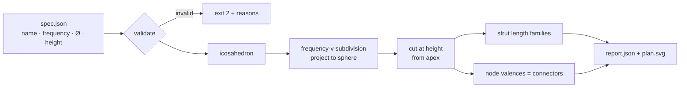

# ساباط — SÁBÁT · parametric pavilion explorer

*by ilghar.studio*

SÁBÁT is a modular pavilion (Ø 370 × H 230 cm; Texcycle yarn, recycled fabric, wood, metal, PLA) that brings Iranian mosaic geometry together with Buckminster Fuller's geodesic domes. It is a space for hospitality, care and shared ritual, rooted in Zoroastrian philosophy. This repository is its **parametric explorer**. You give it a pavilion spec, and it works out the module system you'd need to fabricate:

- **Strut families:** how many module lengths there are, and how many of each to cut.
- **Connectors by valence:** the 3D-printed and machined nodes that join 4, 5 or 6 struts.
- **Built height, panel count and total strut length.**
- **Plan-view SVG** with girih-star panel infills, plus a drag-to-rotate 3D view in `site/index.html`.

## How it works



## Run it (Python ≥ 3.11, no dependencies)

```bash
python3 -m sabat fixtures/sabat_pavilion.json --svg site/sabat_plan.svg
python3 -m unittest
```

Real output for the thesis pavilion (`fixtures/sabat_pavilion.json`: 3V, Ø 370, H 230):

| | |
|---|---|
| built height | 219.7 cm |
| nodes / struts / panels | 61 / 165 / 105 |
| strut families | A 64.5 cm × 30 · B 74.7 cm × 55 · C 76.3 cm × 80 |
| connectors | 15 × 4-way · 6 × 5-way · 40 × 6-way |
| total strut length | 121.47 m |

Open `site/index.html` to see the plan view.

## Original vision: still to build
- **Mosaic layer (started):** each panel now carries a deterministic six-point girih star built from first principles; next: real pattern families inspired by the Ali Qapu music-hall ceiling (1597 CE).
- **Acoustic and atmospheric scoring:** score each panel infill for sound and atmosphere, balancing stability against acoustic harmony.
- **Connector CAD:** generate parametric connector geometry for the three main 3D-printed and machined connectors.
- **Textile envelope:** plan the knitted envelope made from used clothes, as a collection of memories.
- **Structural testing:** add statistical and structural testing.
- **Interactive 3D view (started):** `site/index.html` has a drag-to-rotate vanilla JS/SVG view; next: panel shading and textile envelope.
- **"Gateways to heaven" study:** compare cosmological geometry across Chogha Zanbil, the Isfahan Friday Mosque, the Louvre pyramid and Notre-Dame.

© ilghar.studio. All rights reserved. Private.
