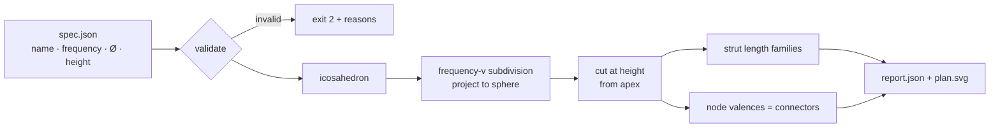

# ساباط — SÁBÁT · parametric pavilion explorer

*by ilghar.studio*

SÁBÁT is a modular pavilion (Ø 370 × H 230 cm; Texcycle yarn, recycled fabric, wood, metal, PLA) that brings Iranian mosaic geometry together with Buckminster Fuller's geodesic domes. It is a space for hospitality, care and shared ritual, rooted in Zoroastrian philosophy. This repository is its **parametric explorer**. You give it a pavilion spec, and it works out the module system you'd need to fabricate:

- **Strut families:** how many module lengths there are, and how many of each to cut.
- **Connectors by valence:** the 3D-printed and machined nodes that join 4, 5 or 6 struts.
- **Built height, panel count and total strut length.**
- **Plan-view SVG** with girih-star panel infills, plus a drag-to-rotate 3D view in `site/index.html`.

## How it works



## Run it (Python ≥ 3.11, no dependencies)

```bash
python3 -m sabat fixtures/sabat_pavilion.json --svg site/sabat_plan.svg
python3 -m unittest
```

Real output for the thesis pavilion (`fixtures/sabat_pavilion.json`: 3V, Ø 370, H 230):

| | |
|---|---|
| built height | 219.7 cm |
| nodes / struts / panels | 61 / 165 / 105 |
| strut families | A 64.5 cm × 30 · B 74.7 cm × 55 · C 76.3 cm × 80 |
| connectors | 15 × 4-way · 6 × 5-way · 40 × 6-way |
| total strut length | 121.47 m |

### Connector table (computed from the geometry)

| hub | count | strut elevation below tangent plane | angle between neighbouring struts |
|---|---|---|---|
| 4-way (rim) | 15 | 11.63–11.91° | 59.99–180° (180° = open rim side) |
| 5-way | 6 | 10.03–10.04° | 71.99–72.01° |
| 6-way | 40 | 10.03–11.91° | 55.68–62.17° |

### Panel openness / acoustic proxy: **heuristic, not a measured acoustic result**

For each panel, the tool reports:

- `infill_ratio`: the girih star's area divided by the panel's area.
- `openness`: 1 − `infill_ratio`.
- `facing_centre`: the |cos| between the panel's normal and the direction to the centre of the floor.
- `focus_proxy`: `infill_ratio` × `facing_centre`, a rough flag for panels that may focus sound.

These are geometric indicators only, with no acoustic simulation or measurement behind them. For the thesis pavilion, the mean openness is 0.7036 and the mean facing_centre is 0.988. Facing is almost uniform because the floor centre sits close to the sphere's centre. Every value is in `fixtures/expected_output.json` under `panel_proxy_HEURISTIC`.

Open `site/index.html` to see the plan view.

## Original vision: still to build
- **Mosaic layer (started):** each panel now carries a deterministic three-pointed girih star (tips toward the corners, waists pulled to the centre) built from first principles; around each 5- and 6-way hub the tips meet as 5- and 6-fold rosettes; next: real pattern families inspired by the Ali Qapu music-hall ceiling (1597 CE).
- **Acoustic and atmospheric scoring:** score each panel infill for sound and atmosphere, balancing stability against acoustic harmony.
- **Connector CAD:** generate parametric connector geometry for the three main 3D-printed and machined connectors.
- **Textile envelope:** plan the knitted envelope made from used clothes, as a collection of memories.
- **Structural testing:** add statistical and structural testing.
- **Interactive 3D view (started):** `site/index.html` has a drag-to-rotate vanilla JS/SVG view; next: panel shading and textile envelope.
- **"Gateways to heaven" study:** compare cosmological geometry across Chogha Zanbil, the Isfahan Friday Mosque, the Louvre pyramid and Notre-Dame.

© ilghar.studio. All rights reserved. Private.
