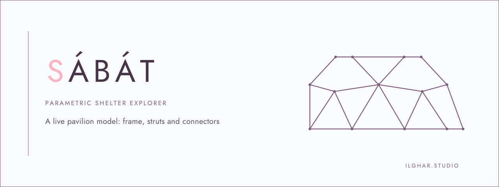
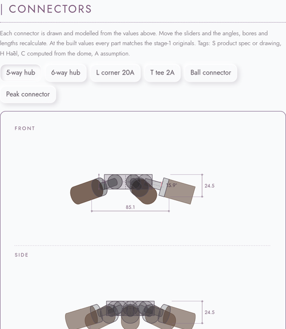
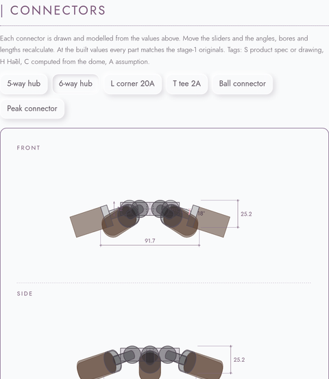
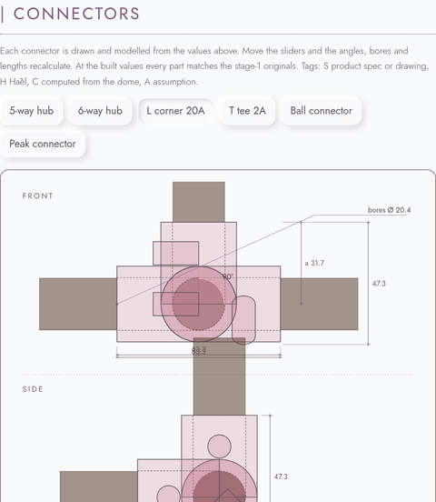
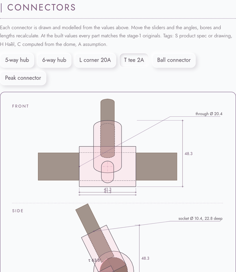
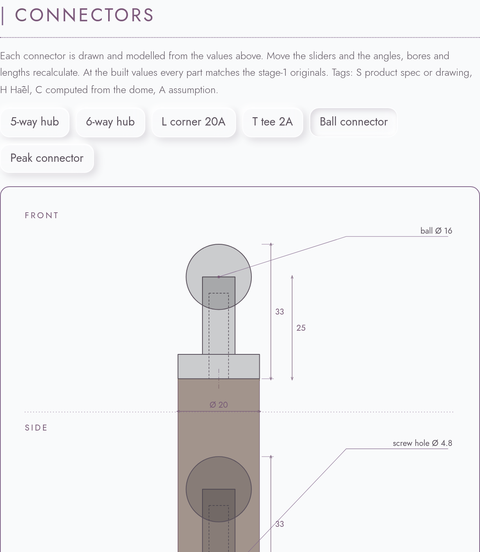
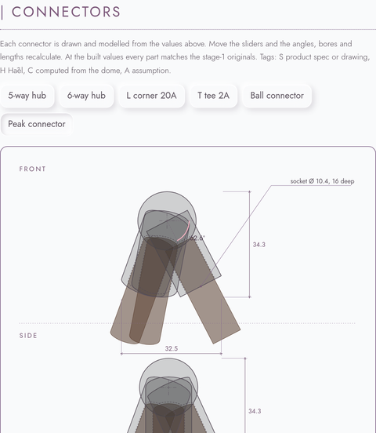
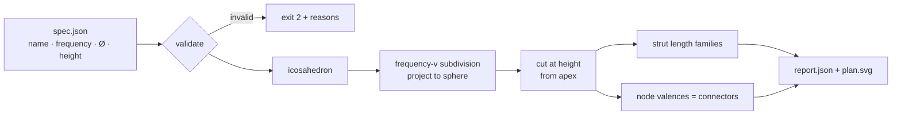

# ساباط — SÁBÁT · parametric pavilion explorer

*by [ilghar.studio](https://ilghar.studio)*

<p>
  <picture>
    <source media="(prefers-color-scheme: dark)" srcset="assets/readme/hero-sabat-dark.svg">
    
  </picture>
</p>

**Live explorer** → [ilghar.github.io/sabat-parametric-explorer](https://ilghar.github.io/sabat-parametric-explorer/)

Sliders for diameter, pyramid peak (built **57 cm**), legs and stick thickness. Covers on/off, entrance open/closed. Connector selector with technical SVG drawings, live 3D and STL download. Parts tables update as the geometry changes.

## Palette & type

| | | | | | | |
|---|---|---|---|---|---|---|
| <span style="display:inline-block;width:1.1em;height:1.1em;border-radius:0;background:#473448;vertical-align:middle"></span> plum `#473448` | <span style="display:inline-block;width:1.1em;height:1.1em;border-radius:0;background:#5a515c;vertical-align:middle"></span> ink `#5a515c` | <span style="display:inline-block;width:1.1em;height:1.1em;border-radius:0;background:#775a76;vertical-align:middle"></span> mauve `#775a76` | <span style="display:inline-block;width:1.1em;height:1.1em;border-radius:0;background:#fcb4c4;vertical-align:middle"></span> pink `#fcb4c4` | <span style="display:inline-block;width:1.1em;height:1.1em;border-radius:0;background:#a6a1a7;vertical-align:middle"></span> muted `#a6a1a7` | <span style="display:inline-block;width:1.1em;height:1.1em;border-radius:0;background:#f9fafb;border:1px solid #856a8e;vertical-align:middle"></span> canvas `#f9fafb` | <span style="display:inline-block;width:1.1em;height:1.1em;border-radius:0;background:#2a272d;vertical-align:middle"></span> dark `#2a272d` |

Sticks walnut `#5b4032` · peak connector `#2a272d`. Typography: **Jost**. The Pages site follows the system light/dark setting by default (`prefers-color-scheme`) and keeps a manual toggle that remembers your choice.

## Connectors (live on Pages)

Each part is drawn and modelled from the slider values. At the built values every part matches the stage-1 originals.

<table>
  <tr>
    <td width="33%"><picture><source media="(prefers-color-scheme: dark)" srcset="assets/readme/hub5-dark.png"></picture><br><sub>5-way hub</sub></td>
    <td width="33%"><picture><source media="(prefers-color-scheme: dark)" srcset="assets/readme/hub6-dark.png"></picture><br><sub>6-way hub</sub></td>
    <td width="33%"><picture><source media="(prefers-color-scheme: dark)" srcset="assets/readme/corner-dark.png"></picture><br><sub>L corner 20A</sub></td>
  </tr>
  <tr>
    <td><picture><source media="(prefers-color-scheme: dark)" srcset="assets/readme/tee-dark.png"></picture><br><sub>T tee 2A</sub></td>
    <td><picture><source media="(prefers-color-scheme: dark)" srcset="assets/readme/ball-dark.png"></picture><br><sub>Ball connector</sub></td>
    <td><picture><source media="(prefers-color-scheme: dark)" srcset="assets/readme/peak-dark.png"></picture><br><sub>Peak connector</sub></td>
  </tr>
</table>

## Built pavilion

Ø 370 × H 230 cm · Texcycle yarn, recycled fabric, wood, metal, PLA · pavilion frame for hospitality, care and shared ritual.

> “SÁBÁT”, a structure commonly found in Yazd, Iran, series of interconnected arches or vaulted ceilings, harmonious blend of hospitality, grace, and cultural resonance.
> <cite>Hāèl, master thesis, 2024</cite>

---

## Also a Python CLI

You give it a pavilion spec, and it works out the module system you'd need to fabricate:

- **Strut families:** how many module lengths there are, and how many of each to cut.
- **Connectors by valence:** the 3D-printed and machined nodes that join 4, 5 or 6 struts.
- **Model height, panel count and total strut length.**

### How it works



### Run it (Python ≥ 3.11, no dependencies)

```bash
python3 -m sabat fixtures/sabat_pavilion.json --svg site/sabat_plan.svg
python3 -m unittest
```

Real output for the thesis pavilion (`fixtures/sabat_pavilion.json`: 3V, Ø 370, H 230):

| | |
|---|---|
| height | Built pavilion H 230 cm; model height 219.7 cm, the panel-row cut closest to it (`sabat/core.py:95`) |
| nodes / struts / panels | 61 / 165 / 105 |
| strut families | A 64.5 cm × 30 · B 74.7 cm × 55 · C 76.3 cm × 80 |
| connectors | 15 × 4-way · 6 × 5-way · 40 × 6-way |
| total strut length | 121.47 m |

### Connector table (computed from the geometry)

| hub | count | strut elevation below tangent plane | angle between neighboring struts |
|---|---|---|---|
| 4-way (rim) | 15 | 11.63–11.91° | 59.99–180° (180° = open rim side) |
| 5-way | 6 | 10.03–10.04° | 71.99–72.01° |
| 6-way | 40 | 10.03–11.91° | 55.68–62.17° |

### Panel acoustic proxy: **heuristic, not a measured acoustic result**

For each panel, the tool reports:

- `facing_centre`: the |cos| between the panel's normal and the direction to the center of the floor.

These are geometric indicators only, with no acoustic simulation or measurement behind them. For the thesis pavilion, the mean facing_centre is 0.988. Facing is almost uniform because the floor center sits close to the sphere's center. Every value is in `fixtures/expected_output.json` under `panel_proxy_HEURISTIC`.

### Robustness
- **Height cut:** the tool picks the panel-row cut whose model height is closest to the target. It prints a warning if the result is more than 5% off, and gives a clear error if the height is too small for the chosen frequency and diameter.
- **Input checks:** it rejects specs that aren't JSON objects, numbers that are NaN, infinite or out of range (diameter 10–100,000 cm), and empty names.
- **Safe output:** the name is escaped in the SVG, and a missing or invalid JSON file gives a clear error message.
- **Strut lengths:** struts are grouped by a relative tolerance rather than by rounding.

### Themes
`site/index.html` is the live explorer. It follows `prefers-color-scheme` on first load, sets `data-theme`, and a button remembers your choice in `localStorage`. All figures, canvases and images are capped to the page column with square frames.

## Original vision: still to build
- **Acoustic and atmospheric scoring:** score each panel infill for sound and atmosphere, balancing stability against acoustic harmony.
- **Textile envelope:** plan the knitted envelope made from used clothes, as a collection of memories.
- **Structural testing:** add statistical and structural testing.
- **"Gateways to heaven" study:** compare cosmological geometry across Chogha Zanbil, the Isfahan Friday Mosque, the Louvre pyramid and Notre-Dame.

## References
[1] Sussan Babaie, “Isfahan x. Monuments (2) Palaces”, *Encyclopaedia Iranica* (published 2007, updated 2014), https://www.iranicaonline.org/articles/isfahan-x2-palaces/ (dates the top floor's decorated private rooms of the ʿĀli Qāpu to around 1615, under Shah ʿAbbās I).

© ilghar.studio. All rights reserved.
